<picture><source media="(max-width: 600px) and (prefers-color-scheme: dark)" srcset="assets/poster-tall-dark.svg"><source media="(max-width: 600px)" srcset="assets/poster-tall-light.svg"><source media="(prefers-color-scheme: dark)" srcset="assets/poster-dark.svg"></picture>

### Recently merged

| Project | Fix | Merged |
|:---|:---|:---|
| [KhronosGroup/KTX-Software-CTS](https://github.com/KhronosGroup/KTX-Software-CTS/pull/87) | Update RGB9E5 golden files for the shared-exponent clamp fix | Oct 19 |
| [enjoy-digital/litesata](https://github.com/enjoy-digital/litesata/pull/42) | frontend/dma: Preserve bus data through Mem2Sector conversion | Oct 19 |
| [tskit-dev/tskit](https://github.com/tskit-dev/tskit/pull/3493) | Fix integer overflow in Tajimas_D | Oct 19 |
| [hyperrealm/libconfig](https://github.com/hyperrealm/libconfig/pull/305) | lib: use checked size arithmetic for internal container growth | Oct 19 |
| [pbs/pycaption](https://github.com/pbs/pycaption/pull/441) | Preserve DFXP captions from divisions with the same language | Oct 19 |
| [opencollab/arpack-ng](https://github.com/opencollab/arpack-ng/pull/502) | ICB: Preserve default tolerance across reverse communication calls | Oct 19 |
| [mljs/matrix](https://github.com/mljs/matrix/pull/223) | fix: use absolute values for max norm | Oct 19 |
| [CESNET/libyang](https://github.com/CESNET/libyang/pull/2591) | plugins types REFACTOR build strings with ly_append_str | Oct 19 |
| [zlib-ng/minizip-ng](https://github.com/zlib-ng/minizip-ng/pull/1073) | zip: read each extra field from a stream bounded to its length | Oct 19 |
| [alibaba/MNN](https://github.com/alibaba/MNN/pull/4985) | [Converter:Bugfix] Honor ONNX Resize's default nearest mode | Oct 19 |

All 60 merged fixes, across 58 projects: [openexr](https://github.com/AcademySoftwareFoundation/openexr), [MNN](https://github.com/alibaba/MNN), [arrow-nanoarrow](https://github.com/apache/arrow-nanoarrow), [sedona](https://github.com/apache/sedona), [astc-encoder](https://github.com/ARM-software/astc-encoder), [gtsam](https://github.com/borglab/gtsam), [casadi](https://github.com/casadi/casadi), [cdk](https://github.com/cdk/cdk), [ceres-solver](https://github.com/ceres-solver/ceres-solver), [libyang](https://github.com/CESNET/libyang), [sv-tests](https://github.com/chipsalliance/sv-tests), [xgboost](https://github.com/dmlc/xgboost), [litesata](https://github.com/enjoy-digital/litesata), [culori](https://github.com/Evercoder/culori), [basix](https://github.com/FEniCS/basix), [flint](https://github.com/flintlib/flint), [fontkit](https://github.com/foliojs/fontkit), [fonttools](https://github.com/fonttools/fonttools), [formatjs](https://github.com/formatjs/formatjs), [fribidi](https://github.com/fribidi/fribidi), [gem5](https://github.com/gem5/gem5), [ghdl](https://github.com/ghdl/ghdl), [hdl-modules](https://github.com/hdl-modules/hdl-modules), [gdstk](https://github.com/heitzmann/gdstk), [libconfig](https://github.com/hyperrealm/libconfig), [ispc](https://github.com/ispc/ispc), [FastTransforms.jl](https://github.com/JuliaApproximation/FastTransforms.jl), [DSP.jl](https://github.com/JuliaDSP/DSP.jl), [keras](https://github.com/keras-team/keras), [KTX-Software](https://github.com/KhronosGroup/KTX-Software), [KTX-Software-CTS](https://github.com/KhronosGroup/KTX-Software-CTS), [libexif](https://github.com/libexif/libexif), [libical](https://github.com/libical/libical), [circt](https://github.com/llvm/circt), [DirectXMath](https://github.com/microsoft/DirectXMath), [matrix](https://github.com/mljs/matrix), [nodatime](https://github.com/nodatime/nodatime), [hifitime](https://github.com/nyx-space/hifitime), [optimizer](https://github.com/onnx/optimizer), [arpack-ng](https://github.com/opencollab/arpack-ng), [cv-hpdcache](https://github.com/openhwfoundation/cv-hpdcache), [OpenMDAO](https://github.com/OpenMDAO/OpenMDAO), [ojAlgo](https://github.com/optimatika/ojAlgo), [pycaption](https://github.com/pbs/pycaption), [Pillow](https://github.com/python-pillow/Pillow), [riscv-tests](https://github.com/riscv-software-src/riscv-tests), [riscv-opcodes](https://github.com/riscv/riscv-opcodes), [awkward](https://github.com/scikit-hep/awkward), [scikit-rf](https://github.com/scikit-rf/scikit-rf), [json](https://github.com/serde-rs/json), [tract](https://github.com/sonos/tract), [universal](https://github.com/stillwater-sc/universal), [taglib](https://github.com/taglib/taglib), [tskit](https://github.com/tskit-dev/tskit), [unicode-segmentation](https://github.com/unicode-rs/unicode-segmentation), [darts](https://github.com/unit8co/darts), [verilator](https://github.com/verilator/verilator), [minizip-ng](https://github.com/zlib-ng/minizip-ng).

Early credits

| Project | Found |
|:---|:---|
| [LiteDRAM](https://github.com/enjoy-digital/litedram/pull/415) | AXI write responses lost under BREADY backpressure |
| [LiteDRAM](https://github.com/enjoy-digital/litedram/pull/416) | DMA AXI byte addressing and WLAST |
| [LiteEth](https://github.com/enjoy-digital/liteeth/pull/281) | ARP cache returning the wrong MAC address |
| [LitePCIe](https://github.com/enjoy-digital/litepcie/pull/193) | MSI-X upper address and masked interrupts |
| [Highway](https://github.com/google/highway/pull/3475) | f64 to f32 demotion overflowing on finite values |

Updated 2026-10-19 from public GitHub records. ChipLab is a Donmakino LLC lab: [chiplab.donmakino.com](https://chiplab.donmakino.com)
